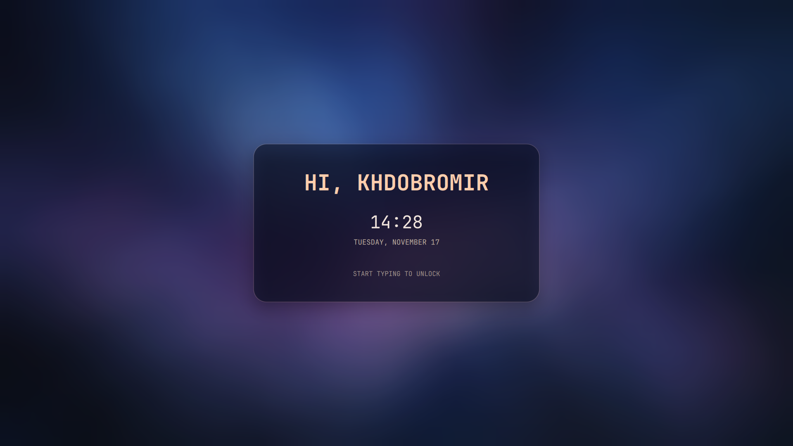

# Ethereal Glass Lockscreen

A frosted-glass lockscreen for Omarchy and Quickshell, with a peach greeting,
clock, date, animated password reveal, peach glow on each newly entered password
dot, and expanding ripple feedback. Uses Omarchy's native session lock and PAM
authentication.



## Installation

Run from an unlocked Omarchy session:

```sh
omarchy plugin install https://github.com/khdobromir/ethereal-glass-lockscreen.git --enable
```
